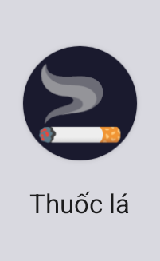
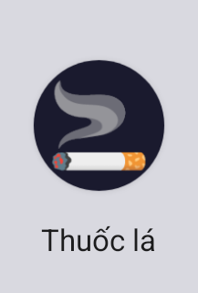

# Task 3.3 — AVD verification record

Device: `emulator-5554`, API 35, 1080×2340 @440 dpi.
Artifact under test: `app-debug.apk`, md5 **1003615b4b557c582e65454b0c45621b**.

Every number in this document is produced by `analyse.py` in this directory, which runs against
the four full screencaps committed beside it. Run `python3 analyse.py` to regenerate all of it;
`SCRIPT-OUTPUT.txt` is its captured output. If a figure here cannot be reproduced by that script,
the figure is wrong and this document should be corrected, not trusted.

**Scope caveat on the script.** Sections 1–3 derive their crop boxes from the largest connected
navy blob, so they adapt to a different layout. Section 4 does not: its per-app grid is hardcoded
to this frame's geometry (5 columns at 201 px pitch from x=20, rows at 353 px pitch from y=345).
Those constants land correctly on `screen-final.png` — all 24 cells were checked — but they are
specific to this emulator's 1080×2340 drawer. Reusing section 4 on a different launcher or grid
size would silently measure the wrong rectangles; re-derive the pitch first.

## Evidence chain (one artifact, not two claims)

`adb install -r` reported `Success` three times while the device kept a **stale pre-icon build**.
The install only became real after a full uninstall, proven by hashing the copy pulled back off
the device:

```
local  app-debug.apk        md5 1003615b4b557c582e65454b0c45621b
device base.apk (pulled)    md5 1003615b4b557c582e65454b0c45621b   -> IDENTICAL

aapt2 dump badging (device copy)
  application: label='Thuốc lá' icon='res/mipmap-anydpi-v26/ic_launcher.xml'
```

That md5 also reproduces from `./gradlew :app:clean :app:assembleDebug` on this branch. Everything
below is attributable to that build.

## 1. Round mask does not clip the mark — PASS

Two different kinds of evidence, kept separate on purpose.

**Exact, from the packaged layer** (`layer-source/ic_launcher_foreground.png`, the same bytes as
`android/app/src/main/res/drawable-nodpi/ic_launcher_foreground.png`):

| property | value |
|---|---|
| canvas | 432×432 px = 108 dp |
| artwork alpha bbox | (112, 116, 319, 316) → 207 × 200 px |
| art centre vs canvas centre | (−0.5, +0.0) px = **−0.12 %** of canvas |
| safe viewport | central 288 px (72 dp), i.e. 72…360 |
| artwork entirely inside safe viewport | **yes** |

This is the claim that matters: the platform can only show the central 72 of 108 dp, and the art
sits well inside it. No mask shape — circle, squircle, teardrop — can clip artwork that is wholly
within the safe viewport.

**Rendered, from the screenshot** (`screen-final.png`): the largest connected navy `#1a1a2e`
component is a **141 × 141 px** blob with aspect ratio **1.000** — a perfect circle, i.e. the AOSP
round mask. That confirms the mask is circular and that the icon renders at the expected size.

A note on what is deliberately *not* claimed: the earlier version of this document reported an
artwork-centre offset and a near-edge pixel count measured from the rendered screenshot. Those
figures were not reproducible. The launcher's own light-grey background is "light", so a brightness
mask cannot separate background from light artwork at this render size; my numbers were partly
counting background. Section 1's layer measurement replaces them and is exact. Containment is not in
doubt — the screenshot is simply the wrong instrument for measuring it.



## 2. Themed-icons (monochrome) — NOT SETTLED, and it is a platform behaviour

Enabling "Themed icons" in *Wallpaper & style* flips a switch that reports `checked=true`, but
**no app on this launcher renders themed**. The per-app table in `analyse.py` section 4 measures
every launcher cell; cells other than ours still show strongly-saturated colour:

```
       cell(x,y)  saturated     navy  note
  (  20, 345)      11.1%     1.0%
  ( 221, 345)      20.2%     1.1%
  ( 422, 345)       8.5%     0.9%
  ( 623, 345)      20.3%     0.7%
  ( 824, 345)       7.4%     1.0%
  ... (see SCRIPT-OUTPUT.txt for all 25 cells)
  (  20,1757)       0.9%    20.1%  <- ours (navy ground)
```

A launcher applying monochrome tinting would drive those saturation figures toward zero. They stay
high, so the platform is not tinting *any* icon. `adb shell settings get secure themed_icons`
returns `null` even with the switch on.

Two separate questions, not to be conflated:

- **Is the monochrome layer present and wired?** YES. The compiled APK's
  `res/mipmap-anydpi-v26/ic_launcher.xml` resolves `<monochrome>` to a real drawable;
  `ic_launcher_monochrome.png` is a 432×432 pure-white alpha silhouette (10.7 % opaque, 100 % of
  artwork pixels r,g,b > 240, bbox 112–318 / 116–314).
- **Does it render as a tinted silhouette here?** **NO OBSERVATION EITHER WAY.** The platform never
  engaged themed icons. An earlier capture appeared to show a change, but that was the launcher's
  icon cache being cleared, not theming — the switch-off and switch-on frames are pixel-identical
  over the icon cell (**0 of 41616 px changed**, `analyse.py` section 3). That diff compares
  `screen-normal.png` against `screen-themed-switch-on.png`, the pair taken from the same scroll
  position so the comparison is valid. `avd-themed-switch-on-cell.png` is the same cell with the
  switch ON: still a full-colour cigarette on navy, not a tinted silhouette.

**Consequence for the spec:** the `app-icon` scenario "Bật Themed icons … icon hiện dạng silhouette
một màu, vẫn nhận ra được là điếu thuốc có khói" is **unverified at runtime**. The wiring and the
asset are correct; the platform behaviour is what could not be exercised. It needs a device or
launcher that actually applies themed icons.



## 3. Large icon at 192 dp is not off-centre — PASS by construction

The stock launcher draws the icon at one size only, so 192 dp could not be observed directly.
What determines it is measured exactly in section 1: the artwork's centre is **0.12 %** of the
canvas off centre. The platform scales the layer uniformly, so a proportional offset stays
proportional at every density — there is no absolute-pixel offset that could grow at 192 dp.

## Frames committed here

| file | what it shows | icon cell at |
|---|---|---|
| `screen-normal.png` | app drawer, themed icons OFF | (830,1720) |
| `screen-themed-switch-on.png` | same drawer with the themed switch ON | (830,1720) |
| `screen-themed-after-cache-clear.png` | after `pm clear` on the launcher, which reset the layout | (68,1784) |
| `screen-final.png` | drawer frame used for geometry and per-app measurements | (68,1784) |
| `avd-normal-mask.png` | crop from `screen-final.png` | — |
| `avd-themed-attempt.png` | crop from the cache-cleared frame | — |
| `avd-themed-switch-on-cell.png` | crop from the switch-ON frame, showing the icon still untinted | — |

The icon moves between the two frame pairs because `pm clear` reset the launcher layout. Crops are
taken from each frame's own measured cell position, not a shared coordinate.

## What is NOT proven here

- **OEM squircle masks.** Only the stock circular mask exists on this AVD. Containment is satisfied
  by the layer geometry (section 1), but no squircle was observed.
- **Themed-icon rendering**, per section 2. This is why task 3.3 stays unticked.
- **Release APK.** `app-debug.apk` only.

## Commands

```
~/Android/Sdk/emulator/emulator -avd thuocla-api35 -no-window -no-audio -gpu swiftshader_indirect
adb uninstall vn.dinhtrung.thuocla
adb install -r app/build/outputs/apk/debug/app-debug.apk
adb shell am start -a android.intent.action.MAIN -c android.intent.category.HOME
adb shell input swipe 540 2200 540 700 300          # open app drawer
adb exec-out screencap -p > screen-final.png
adb shell pm path vn.dinhtrung.thuocla                # pull the installed copy and md5 it
aapt2 dump badging <pulled.apk>
aapt2 dump xmltree --file res/mipmap-anydpi-v26/ic_launcher.xml app-debug.apk
python3 analyse.py                                    # regenerates every figure above
```